<h1 align="center">Drones, Deadlines and NP-Hardness – CVRP with a Genetic Algorithm and Tabu Search</h1>

<p align="center">CMP 3005 – Analysis of Algorithms · Term Project · Bahçeşehir University · Fall 2026</p>

<p align="center">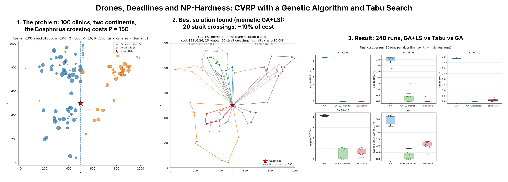</p>

<p align="center"><sub>Left: the 100-clinic team instance. Middle: best solution found (GA+LS, 15 routes, 20 strait crossings). Right: final gap to the best known cost, 10 runs per algorithm.</sub></p>

<p align="center">


</p>

## Contents

[Purpose](#purpose) · [Team](#team) · [How it works](#how-it-works) · [Key results](#key-results) ·
[Parameter tuning](#parameter-tuning) · [Gallery](#gallery) · [Deliverables](#deliverables) · [Rules](#rules) ·
[Install](#install) · [Quick start](#quick-start) · [Folder layout](#folder-layout) ·
[Report items](#report-items-command-and-output-file) · [Expected runtimes](#expected-runtimes) · [Seeds](#seeds) ·
[Reproducing everything](#reproducing-everything) · [Tests](#tests) ·
[Own code and adapted ideas](#own-code-and-adapted-ideas) · [Sources](#sources)

## Purpose

MediDrone Istanbul (a fictional start-up) delivers medical supplies by drone from a central lab to
clinics on both sides of the Bosphorus. Every drone has a payload capacity, so the deliveries must be
split into several routes of minimum total flight distance. This is the Capacitated Vehicle Routing
Problem (CVRP), an NP-hard generalization of the TSP. The project proves NP-hardness, then designs,
implements, analyzes and evaluates a constructive baseline and two metaheuristics.

The code:
- parses CVRPLIB / TSPLIB instances (Augerat set A) and their best-known solutions (BKS);
- generates our own MediDrone team instance (100 customers, Bosphorus penalty P = 150) and tiny instances
  (n = 7, 8, 9) with exact optima;
- solves CVRP with:
  - Clarke–Wright savings (deterministic baseline);
  - a Genetic Algorithm on giant tours decoded by the Split dynamic program, plain and memetic (GA+LS);
  - Tabu Search on route-based solutions;
- validates every reported solution with an independent feasibility checker;
- runs reproducible experiments (fixed seeds, equal time budgets) and writes raw CSV results, tables and figures.

## Team

Joohyun Lee · Ahmet Emre Cinel · Mohammad Ammar Hawwari

## How it works

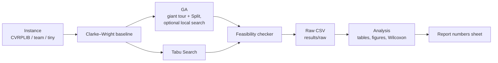

<table>
<tr>
<td width="50%">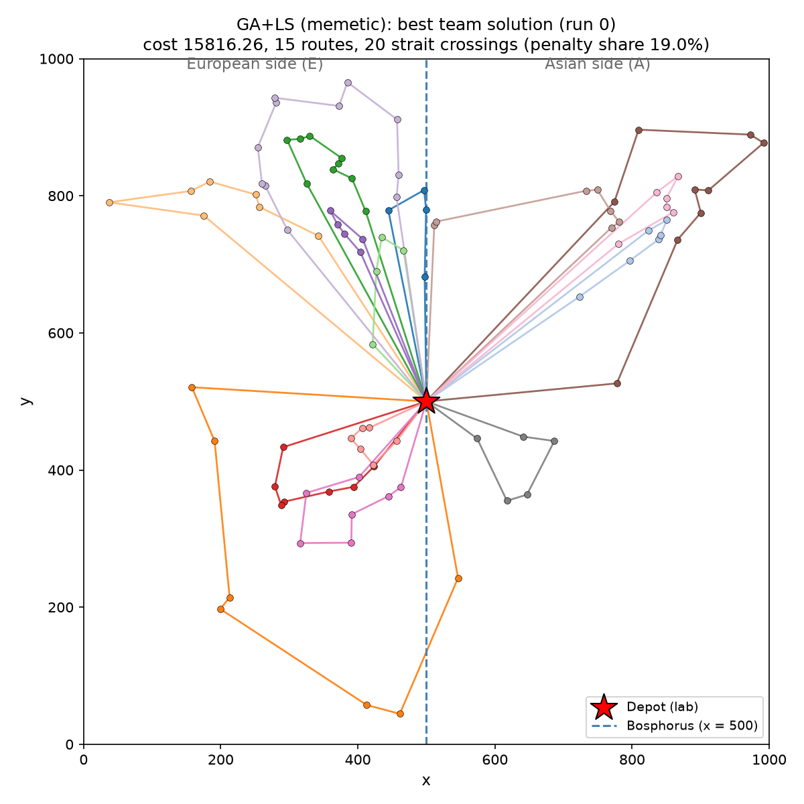<br><sub><i>Best team solution of GA+LS: cost 15816.26, 15 routes, 20 strait crossings.</i></sub></td>
<td width="50%">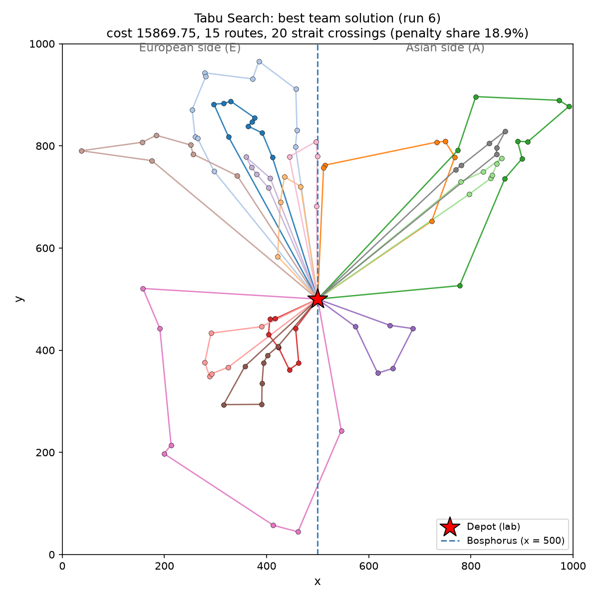<br><sub><i>Best team solution of Tabu Search: cost 15869.75, 15 routes, 20 strait crossings.</i></sub></td>
</tr>
</table>

## Key results

| Instance | GA | GA+LS | Tabu Search |
|---|---|---|---|
| A-n32-k5 | 5.485 | **0.000** | **0.000** |
| A-n45-k6 | 3.464 | 0.381 | **0.095** |
| A-n60-k9 | 3.855 | **0.000** | 0.089 |
| A-n80-k10 | 4.135 | **0.539** | 0.669 |
| team | 3.003 | **0.232** | 1.048 |
| tiny_n7 | **0.000** | **0.000** | **0.000** |
| tiny_n8 | **0.000** | **0.000** | **0.000** |
| tiny_n9 | **0.000** | **0.000** | **0.000** |

Mean gap to the reference (%). Source: `results/tables/main_results.md` (column `mean_gap_pct`, 10 runs per cell).
Reference: BKS for A-n*, the best cost known to us for team (not proven optimal), the exact optimum for tiny_n*.
Bold = lowest in the row.

<table>
<tr>
<td width="50%">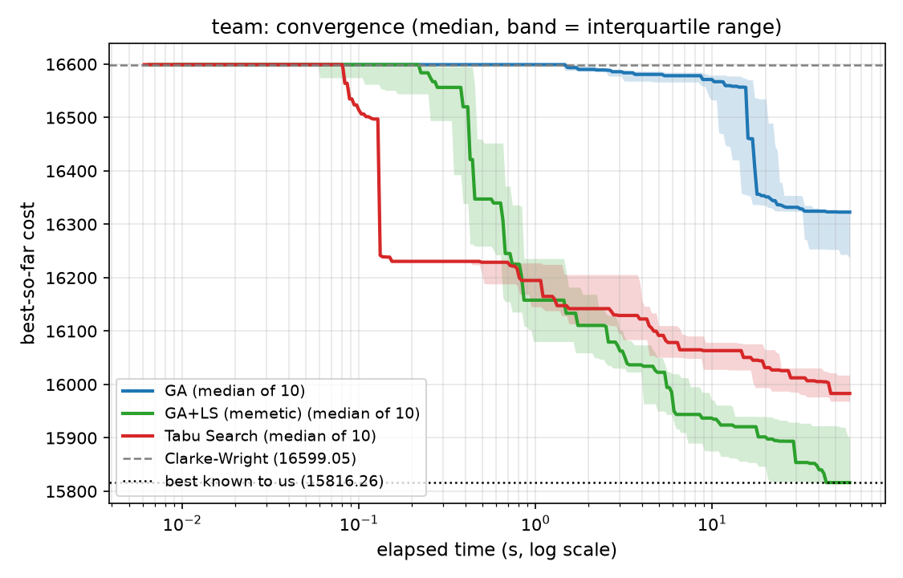<br><sub><i>Best cost over time on the team instance (median of 10 runs, band = interquartile range).</i></sub></td>
<td width="50%">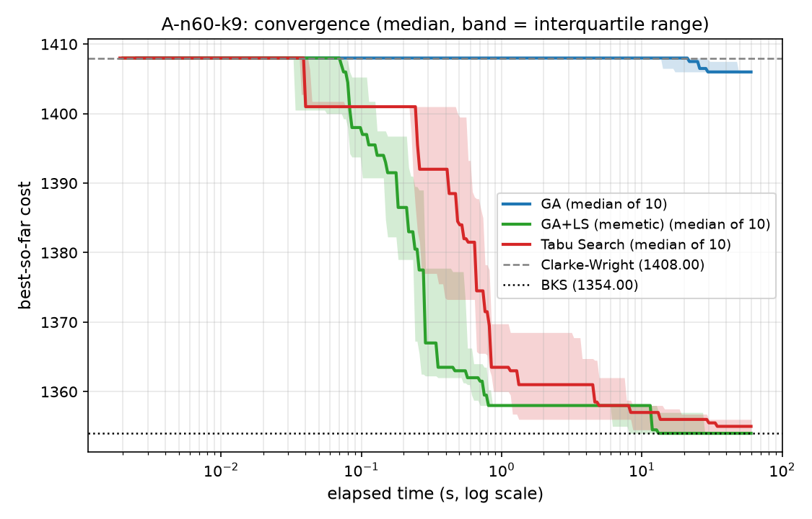<br><sub><i>Best cost over time on A-n60-k9 (median of 10 runs, band = interquartile range).</i></sub></td>
</tr>
</table>

- **Runs:** 3 algorithms × 8 instances × 10 seeded runs = 240, with equal time budgets per instance; all 240 solutions pass `cvrp.checker.check` (0 failures).
- **Best-known solutions reached** (4 Augerat instances × 10 runs = 40): GA+LS 28/40, Tabu Search 22/40, plain GA 0/40.
- **Team instance:** best cost known to us 15816.26, found by GA+LS (6 of 10 runs); 15 routes and 20 strait crossings (19.0% of the cost). All 30 team solutions cross exactly 20 times.
- **Measured slopes vs theory (n ≥ 100):** GA generation 2.01 vs 1 (fallback to the O(n²) K-limited Split); Tabu iteration 1.18 vs 1 (1.07 from moves per iteration, 0.11 from time per move); move evaluation: delta 0.25 vs 0, full 1.03 vs 1.

<p align="center">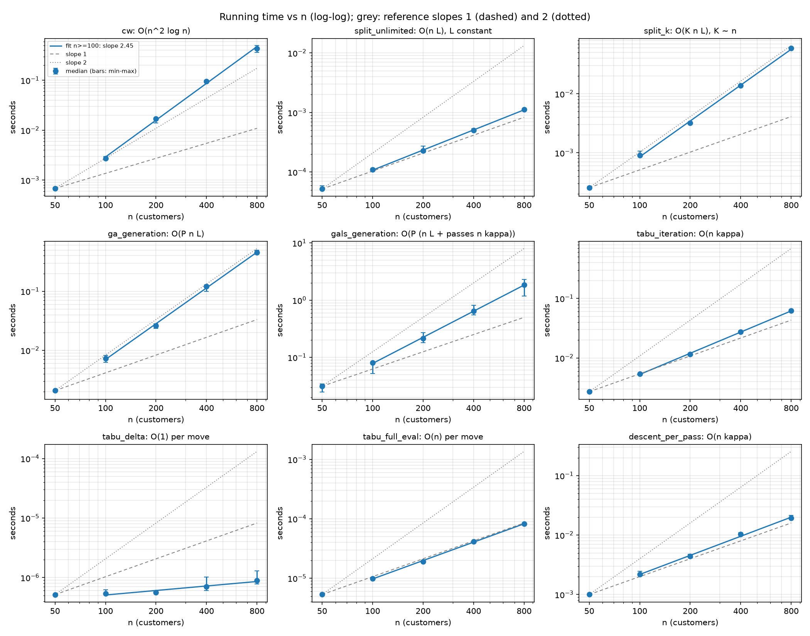<br><sub><i>Measured running time vs n (log-log), main components.</i></sub></p>

<table>
<tr>
<td width="50%">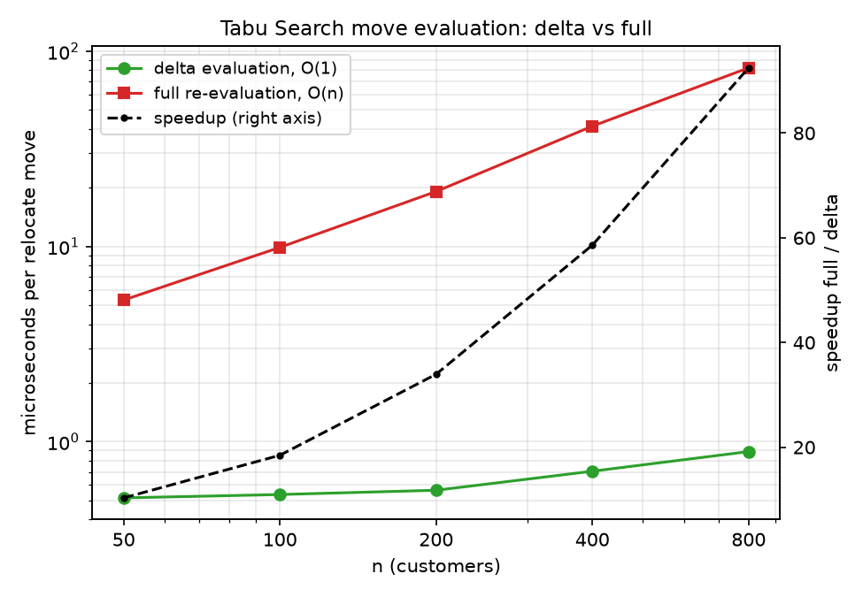<br><sub><i>Time per move: O(1) delta vs full re-evaluation.</i></sub></td>
<td width="50%">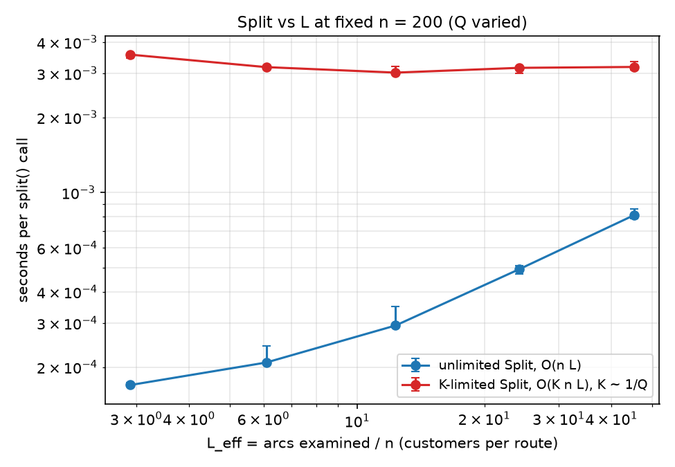<br><sub><i>Split time vs customers per route L (n = 200).</i></sub></td>
</tr>
</table>

- **Wilcoxon + Holm (α = 0.05):** GA+LS and Tabu Search both beat plain GA on all five larger instances; GA+LS beats Tabu Search only on the team instance (not significant on A-n45/60/80, ties on A-n32-k5).

## Parameter tuning

- **Round 1:** one factor at a time around the defaults, 26 configurations × 3 instances × 5 runs × 10 s on tuning seeds 1000–1004, validated on the held-out seeds 1005–1009; the final seeds 20260–20269 are never used.
- **Round 2:** 7 named Tabu Search configurations and a one-factor study of GA+LS, 4 instances × 5 runs × 15 s; the rule picks the configuration with the fewest changes within one SE of the best.
- **Used in the main run** (`experiments/tuned_params.json`): GA population 25, elite 20, crossover 0.6; GA+LS population 10, elite 5, 20 neighbours; Tabu Search candidate list 20, λ ×3 every 3 iterations, tenure 5–15.

<p align="center">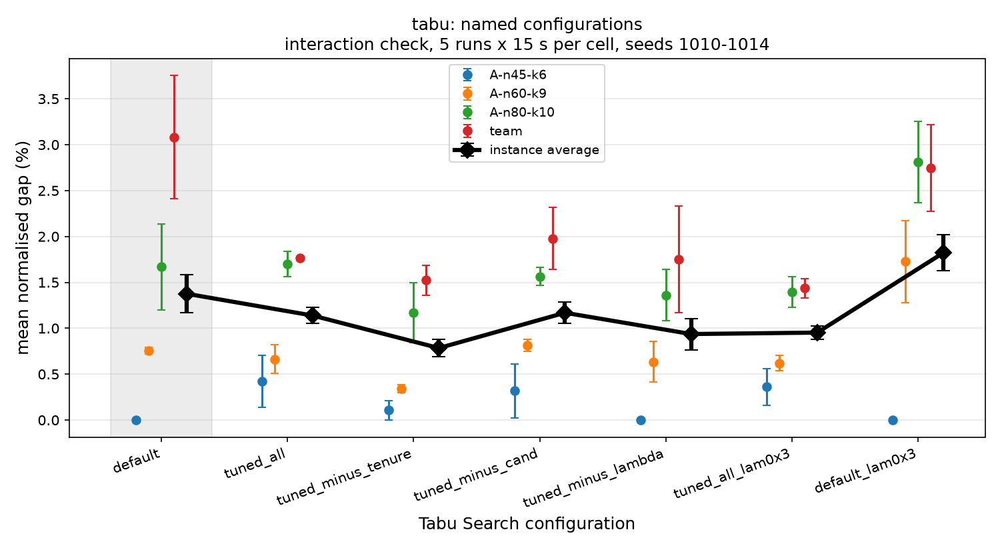<br><sub><i>Round 2: the 7 Tabu Search configurations, per instance (SE bars) and averaged.</i></sub></p>

<table>
<tr>
<td width="50%">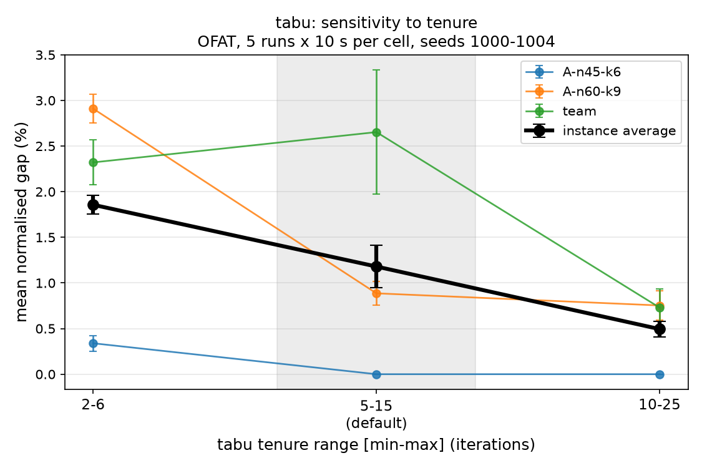<br><sub><i>Round 1: Tabu Search tenure.</i></sub></td>
<td width="50%">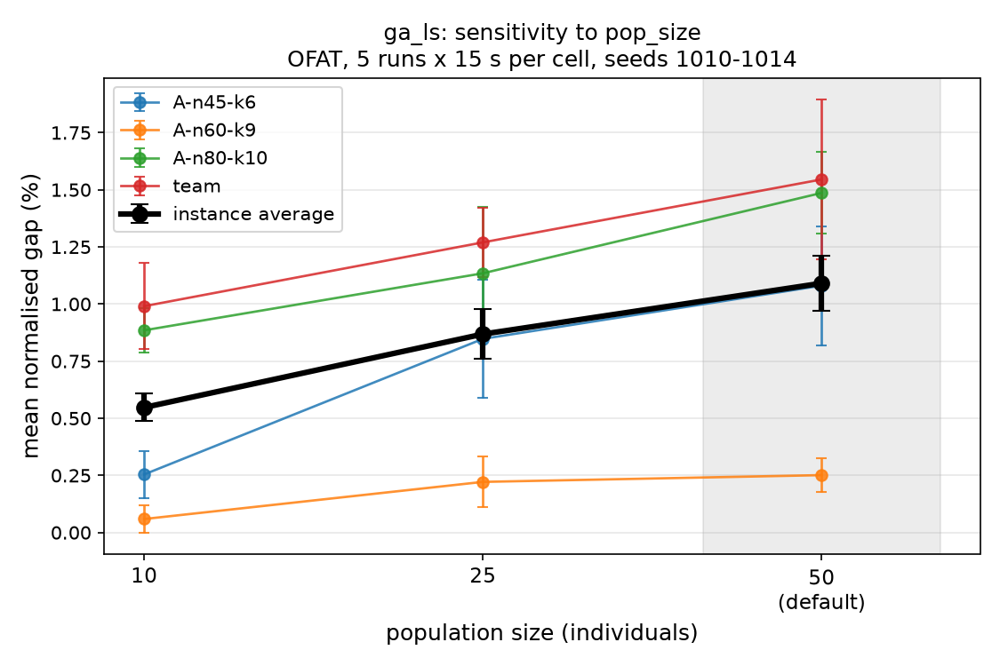<br><sub><i>Round 2: GA+LS population size.</i></sub></td>
</tr>
</table>

## Gallery

<table>
<tr>
<td width="50%">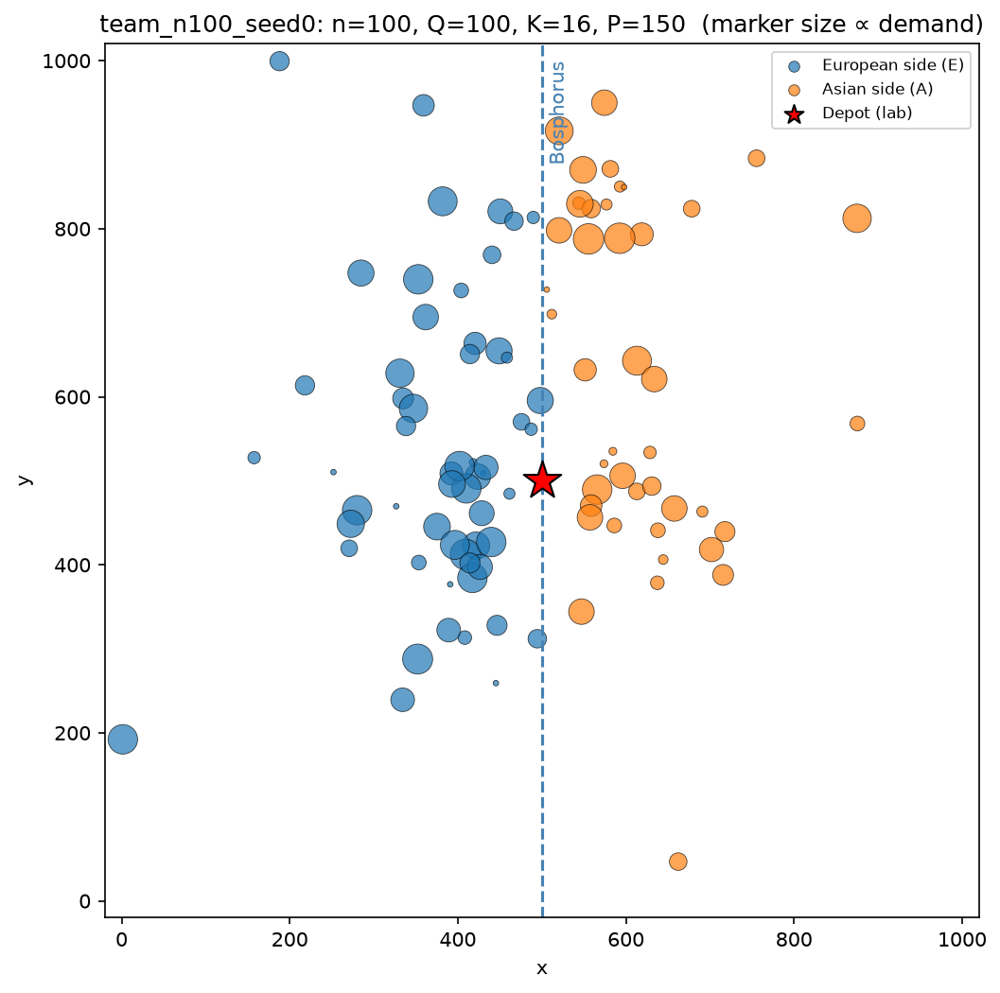<br><sub><i>The MediDrone team instance (100 clinics, P = 150).</i></sub></td>
<td width="50%">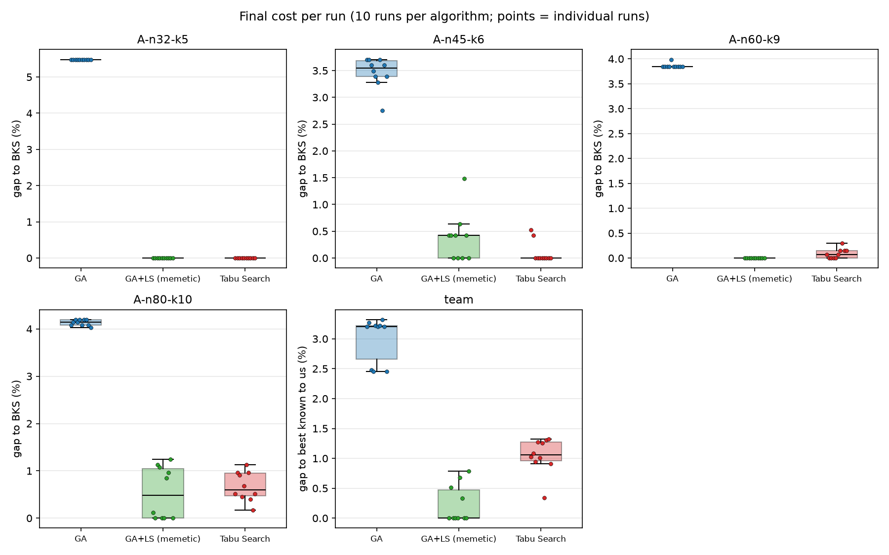<br><sub><i>Final gap per algorithm, 10 runs per instance.</i></sub></td>
</tr>
<tr>
<td width="50%">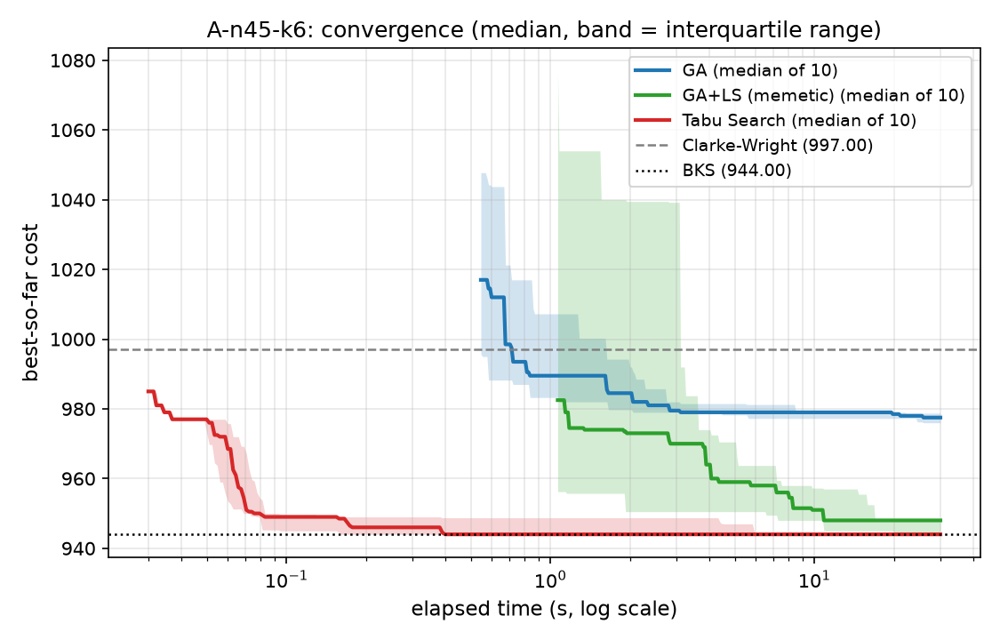<br><sub><i>Convergence on A-n45-k6 (median of 10 runs).</i></sub></td>
<td width="50%">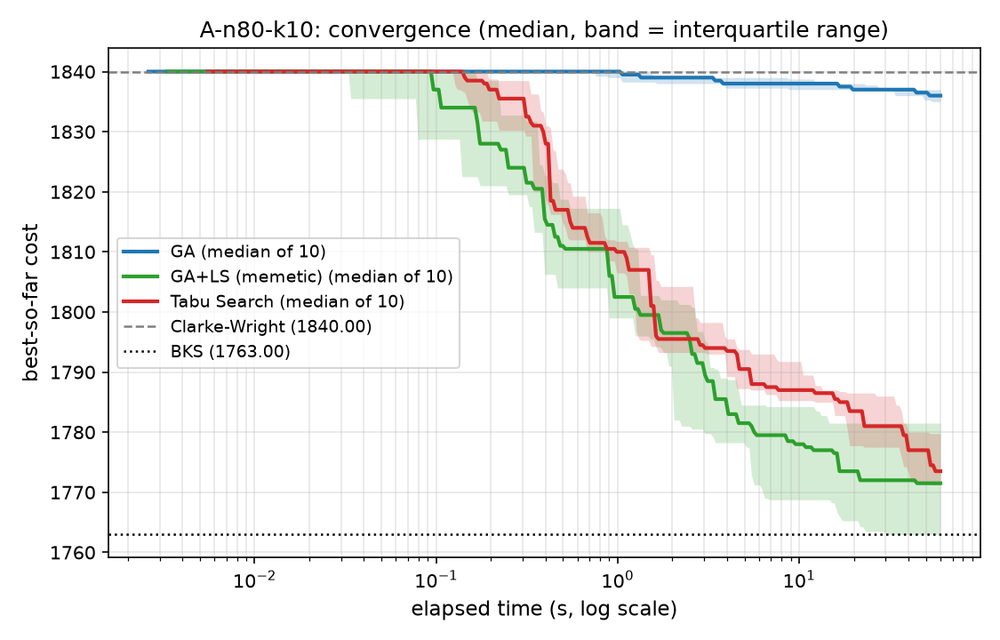<br><sub><i>Convergence on A-n80-k10 (median of 10 runs).</i></sub></td>
</tr>
</table>

## Deliverables

- Report (PDF): [CVRP_Term_Project_Report.pdf](docs/report/CVRP_Term_Project_Report.pdf)
- Slides: [docs/slides/](docs/slides/) (editable PPTX and PDF)

## Rules

- **No external solvers.** OR-Tools, VROOM, HGS-CVRP, PyVRP, jMetal, PuLP, scipy.optimize and the networkx
  algorithms are not used. Every algorithm is written from scratch.
- **Allowed libraries:** numpy, matplotlib, pytest, `scipy.stats.wilcoxon` (the Wilcoxon test only) and the Python
  standard library.
- Every stochastic function takes an explicit seed; every reported solution passes `cvrp.checker.check`.

## Install

Windows, PowerShell, Python 3.11+ (we use 3.12). From the repository root:

```powershell
py -3.12 -m venv .venv
```

```powershell
.\.venv\Scripts\Activate.ps1
```

```powershell
python -m pip install --upgrade pip
```

```powershell
pip install -r requirements.txt
```

```powershell
pip install -e .
```

```powershell
python -c "import numpy, matplotlib, pytest, scipy, cvrp; print('ok')"
```

If activation is blocked by the execution policy, run this once and retry:

```powershell
Set-ExecutionPolicy -Scope CurrentUser RemoteSigned
```

## Quick start

Run every command from the repository root with the venv active. The data files are already committed.

**Clarke–Wright baseline.** Prints the cost, number of routes vs K, gap to the BKS, runtime, the checker verdict and
the routes:

```powershell
python -m cvrp.savings data/cvrplib/A-n32-k5.vrp
```

**Genetic Algorithm** (giant tour + Split). Add `--memetic` for intra-route 2-opt. The other options are `--pop`,
`--pc`, `--pm`, `--gens` and `--penalty`:

```powershell
python -m cvrp.ga data/cvrplib/A-n32-k5.vrp --seed 0 --time 10
```

**Memetic GA with inter-route local search (GA+LS).** `--ls-mode full` applies a granular first-improvement descent
(relocate, swap, 2-opt*, 2-opt under hard capacity) to a share `--ls-prob` of the offspring. `--ls-neighbours` sets
the size of the neighbour lists. In the experiment runner this variant is the algorithm `ga_ls`:

```powershell
python -m cvrp.ga data/cvrplib/A-n60-k9.vrp --seed 0 --time 10 --memetic --ls-mode full --ls-prob 0.5
```

**Tabu Search.** Granular, with soft capacity and adaptive λ. The other options are `--iters`, `--tenure-min`,
`--tenure-max`, `--cand` and `--moves relocate,swap,two_opt_star,two_opt`:

```powershell
python -m cvrp.tabu data/cvrplib/A-n32-k5.vrp --seed 0 --time 10
```

**Smoke checks of the pipelines.** These write to git-ignored `results/smoke*/` folders and take about a minute in
total:

```powershell
python -m experiments.run_experiments --smoke
```

```powershell
python -m experiments.timing --smoke
```

## Folder layout

```
cvrp-project/
  README.md
  requirements.txt, pyproject.toml
  data/
    cvrplib/           Augerat A instances (.vrp) + best-known solutions (.sol)
    team/              our MediDrone instance (team_n100_seed14835.vrp; seed0 = old placeholder for tests)
    tiny/              tiny instances (n = 7, 8, 9) with exact optima (.opt.json)
  src/cvrp/
    instance.py        Instance dataclass + distance functions
    parser.py          CVRPLIB/TSPLIB .vrp and .sol parsing
    generator.py       team + tiny instance generator
    solution.py        solution representation + cost
    checker.py         independent feasibility checker
    exact_small.py     exact solver for n <= 9
    summary.py         Milestone 1 summary table
    plot_instance.py   Milestone 1 instance plot
    savings.py         Clarke–Wright savings
    split.py           Split DP (incl. max-K-routes version)
    ga.py              Genetic Algorithm (plain, memetic, GA+LS)
    local_search.py    2-opt, O(1) move deltas, granular lists, descent
    tabu.py            Tabu Search
  experiments/
    config.py          instances, budgets, seeds, algorithm registry
    run_experiments.py main experiment runner (Task 7)
    tuning.py, tuning_grid.py   parameter study, rounds 1 and 2
    tuned_params.json  selected parameters
    analysis.py        tables and figures of the main run
    solutions.py       reader for the saved per-run solutions
    timing.py          complexity timing experiment
    report_numbers.py  writes docs/report_numbers.md
  results/
    raw/               main run: runs.csv, progress.csv, hardware.txt, solutions/*.json
    tuning/, tuning2/  raw results of the two tuning rounds
    timing/            raw timings, GA+LS cost shares, hardware.txt
    tables/            summary tables (.csv and .md)
    figures/           plots and route maps
  tests/               pytest test suite
  docs/                course brief, step notes, report numbers sheet
    img/               README banner
```

## Report items: command and output file

| Report item | Command | Output file |
|---|---|---|
| Instance summary (Milestone 1) | `python -m cvrp.summary` | printed table |
| Team instance plot | `python -m cvrp.plot_instance data/team/team_n100_seed14835.vrp --out results/figures/team_instance.png` | `results/figures/team_instance.png` |
| Tuning round 1 tables | `python -m experiments.tuning analyze` | `results/tables/tuning_{summary,selection,validation}.csv` |
| Sensitivity figures | `python -m experiments.tuning analyze` (and `--round 2`) | `results/figures/sensitivity_<algo>_<param>.png` |
| Tuning round 2 tables | `python -m experiments.tuning analyze --round 2` | `results/tables/tuning2_{summary,selection,validation}.csv` |
| Tabu configurations (round 2) | `python -m experiments.tuning analyze --round 2` | `results/figures/tuning2_tabu_configs.png` |
| Tuned parameters | `python -m experiments.tuning analyze --round 2` | `experiments/tuned_params.json` |
| Raw per-run results | `python -m experiments.run_experiments --algos ga,ga_ls,tabu --params-file experiments/tuned_params.json --workers 3` | `results/raw/runs.csv`, `progress.csv`, `solutions/` |
| Main results table | `python -m experiments.analysis` | `results/tables/main_results.{csv,md}` |
| Clarke–Wright baseline table | `python -m experiments.analysis` | `results/tables/cw_baseline.{csv,md}` |
| Tiny instances table | `python -m experiments.analysis` | `results/tables/tiny_results.{csv,md}` |
| Wilcoxon table | `python -m experiments.analysis` | `results/tables/wilcoxon.{csv,md}` |
| Team crossings table | `python -m experiments.analysis` | `results/tables/team_crossings.{csv,md}` |
| Convergence figures | `python -m experiments.analysis` | `results/figures/convergence_<instance>.png` |
| Boxplots of final costs | `python -m experiments.analysis` | `results/figures/boxplots_final.png` |
| Team route maps | `python -m experiments.analysis` | `results/figures/team_routes_{ga_ls,tabu}.png` |
| Raw timings, GA+LS cost shares | `python -m experiments.timing` | `results/timing/timing.csv`, `share_ga_ls.csv` |
| Complexity fits table | `python -m experiments.timing` | `results/tables/complexity_fits.{csv,md}` |
| Complexity figures | `python -m experiments.timing` | `results/figures/complexity_<component>.png`, `complexity_overview.png` |
| Split vs L, delta vs full | `python -m experiments.timing` | `results/figures/split_vs_L.png`, `delta_vs_full.png` |
| Every number for the report | `python -m experiments.report_numbers` | `docs/report_numbers.md` |

`docs/report_numbers.md` collects the setup (commits, hardware, seeds, budgets), the instances, the parameters, all
result tables and the key findings, each read from the files above. Quote report numbers from there or from the CSV
files, never from memory.

## Expected runtimes

Measured on the machine in `results/raw/hardware.txt` (8 cores).

| Step | Command | Time |
|---|---|---|
| Test suite | `python -m pytest` | about 1 minute |
| Smoke checks | `--smoke` of `run_experiments` / `timing` | about 1 minute / a few seconds |
| Tuning round 1 (study + validation) | `python -m experiments.tuning run --workers 3` (+ `--validate`) | about 22 minutes + validation (1 worker: about 65 minutes) |
| Tuning round 2 (study + validation) | `python -m experiments.tuning run --round 2 --workers 3` (+ `--validate`) | about 28 + 7 minutes (1 worker: about 85 minutes) |
| Main run (3 algorithms × 8 instances × 10 runs) | see the table above | about 45 minutes with 3 workers (about 2 hours with 1) |
| Timing experiment | `python -m experiments.timing` | about 5 minutes (needs a quiet CPU) |
| Analysis | `python -m experiments.analysis` | a few seconds |
| Report numbers sheet | `python -m experiments.report_numbers` | under a second |

## Seeds

- **Final runs:** run r uses seed `BASE_SEED + r`, with `BASE_SEED = 20260`, so the seeds are 20260–20269. The same
  seed values are used by every algorithm. The value itself is arbitrary but fixed (`experiments/config.py`).
- **Tuning runs** use separate seeds (1000–1019) and never the final seeds.
- **Team instance:** seed **14835**, the sum of the last four digits of the three members' student IDs (the rule is
  stated in the report). Only the resulting seed is stored in the repository.

## Reproducing everything

The steps below recreate every committed result. Each step reads the output of the steps before it; the details are
in the step notes in `docs/`.

<details>
<summary>Show the full reproduction steps</summary>

**1. Benchmark data (Augerat set A, CVRPLIB).** The files are already in `data/cvrplib/`. To re-download them:

```powershell
$base = "https://galgos.inf.puc-rio.br/cvrplib/en/download"
$ids = @{ "A-n32-k5" = 4; "A-n45-k6" = 16; "A-n60-k9" = 23; "A-n80-k10" = 31 }
foreach ($name in $ids.Keys) {
    Invoke-WebRequest "$base/instance/$($ids[$name])" -OutFile "data/cvrplib/$name.vrp"
    Invoke-WebRequest "$base/bks/$($ids[$name])" -OutFile "data/cvrplib/$name.sol"
}
```

**2. Team instance.** Writes `data/team/team_n100_seed14835.vrp` (14835 is the default seed). The old placeholder file
`team_n100_seed0.vrp` is kept for the tests and the Step 3/5 benchmarks.

```powershell
python -m cvrp.generator --seed 14835
```

**3. Tiny instances and their exact optima.** Writes `data/tiny/tiny_n{7,8,9}.vrp` and `.opt.json`. The generator
searches for the first seed where Clarke–Wright is not optimal; GA and TS start from CW, so reaching the optimum is a
real test. The chosen seeds are **n=7: 12, n=8: 22, n=9: 19**, with CW 3.96%, 3.46% and 4.56% above the optimum.

```powershell
python -m cvrp.generator --tiny
```

```powershell
python -m cvrp.exact_small
```

**4. Milestone 1: summary table and team-instance plot.**

```powershell
python -m cvrp.summary
```

```powershell
python -m cvrp.plot_instance data/team/team_n100_seed14835.vrp --out results/figures/team_instance.png
```

**5. Parameter study, round 1 (Step 6b).** One-factor-at-a-time study around the defaults: 26 configurations ×
3 instances (A-n45-k6, A-n60-k9, team) × 5 runs × 10 s on tuning seeds 1000–1004, then validation of tuned vs default
on the held-out seeds 1005–1009. All commands can be resumed. Details are in `docs/step6b_notes.md`.

```powershell
python -m experiments.tuning run --workers 3
```

```powershell
python -m experiments.tuning analyze
```

```powershell
python -m experiments.tuning run --validate --workers 3
```

```powershell
python -m experiments.tuning analyze
```

**6. Parameter study, round 2 (Step 6b-2).** Named Tabu Search configurations and an OFAT study of `ga_ls`:
17 configurations × 4 instances (adds A-n80-k10) × 5 runs × 15 s on seeds 1010–1014, validation on 1015–1019. Outputs
go to `results/tuning2/` and `results/tables/tuning2_*.csv`; round-1 files are not touched. The analysis writes the
final `experiments/tuned_params.json` (sections `ga`, `ga_ls`, `tabu`, `ga_memetic`).

```powershell
python -m experiments.tuning run --round 2 --workers 3
```

```powershell
python -m experiments.tuning analyze --round 2
```

```powershell
python -m experiments.tuning run --round 2 --validate --workers 3
```

```powershell
python -m experiments.tuning analyze --round 2
```

**7. Main experiments (Task 7, Step 6a).** 10 seeded runs per instance and algorithm, with equal time budgets for all
algorithms on an instance. It can be resumed: finished runs are skipped. Raw CSV goes to `results/raw/`, and every run
also saves its routes to `results/raw/solutions/<instance>_<algo>_run<r>.json` (`experiments/solutions.py` reads them).
Details are in `docs/step6a_notes.md`.

```powershell
python -m experiments.run_experiments --algos ga,ga_ls,tabu --params-file experiments/tuned_params.json --workers 3
```

**8. Analysis of the main run (Step 6c).** Reads `results/raw/` (read-only) and writes the main-run tables and figures.
Details are in `docs/step6c_notes.md`.

```powershell
python -m experiments.analysis
```

**9. Complexity validation (Step 6d).** Measures how the running time grows with n (50–800) for Clarke–Wright, Split,
a GA and GA+LS generation, a Tabu Search iteration, delta vs full move evaluation and the descent, then fits log-log
slopes against the theory. Run it on a **quiet CPU**. Details are in `docs/step6d_notes.md`.

```powershell
python -m experiments.timing
```

**10. Report numbers sheet (Step 7a).** Details of the reproducibility check are in `docs/step7a_notes.md`.

```powershell
python -m experiments.report_numbers
```

</details>

**Other benchmarks used in the step notes.** Mean time per `split()` call on 200 random tours, and the O(1) delta vs a
full re-evaluation per move:

```powershell
python -m cvrp.split --benchmark
```

```powershell
python -m cvrp.tabu --benchmark-delta
```

## Tests

Run the full suite:

```powershell
python -m pytest
```

Slow exhaustive checks (for example Split over all 9! permutations, about 7 s) are skipped by default. Run them with:

```powershell
python -m pytest -m slow
```

Run one test file:

```powershell
python -m pytest tests/test_checker.py
```

The suite covers, among others:
- parsing of all four Augerat instances, and each BKS .sol passing the checker with the stated cost;
- the checker catching every kind of violation;
- for the team instance: the triangle inequality on all 101³ triples, the side labels, determinism and the
  write → parse round trip;
- the exact solver against a brute force on `tiny_n7`;
- every O(1) move delta against a full recomputation;
- the experiment, tuning, analysis, timing and report-numbers scripts on small synthetic or smoke inputs.

Step-by-step design notes are in `docs/step*_notes.md`.

## Own code and adapted ideas

All code in this repository is our own. The following parts follow published descriptions (pseudocode and papers),
not code from any library or repository:

- Clarke–Wright savings: Clarke & Wright (1964);
- the Split procedure for decoding giant tours: Prins (2004);
- 2-opt: Croes (1958);
- the granular neighbourhood (candidate lists) of the Tabu Search: Toth & Vigo (2003);
- the basic Genetic Algorithm and Tabu Search structure: Glover & Laguna (1997).

No code was copied from any library or repository. The only libraries used are numpy, matplotlib, pytest and
`scipy.stats` (the Wilcoxon test only), plus the Python standard library.

## Sources

- G. Clarke & J. W. Wright, "Scheduling of vehicles from a central depot to a number of delivery points," *Operations Research*, 1964.
- C. Prins, "A simple and effective evolutionary algorithm for the vehicle routing problem," *Computers & Operations Research*, 2004.
- G. A. Croes, "A method for solving traveling-salesman problems," *Operations Research*, 1958.
- F. Glover & M. Laguna, *Tabu Search*, Kluwer, 1997.
- P. Toth & D. Vigo, "The granular tabu search and its application to the vehicle-routing problem," *INFORMS Journal on Computing*, 2003.
- P. Toth & D. Vigo (eds.), *Vehicle Routing: Problems, Methods, and Applications*, 2nd ed., SIAM, 2014.
- M. R. Garey & D. S. Johnson, *Computers and Intractability*, 1979.
- CVRPLIB benchmark library (instances and best-known solutions).

---

© 2026 Mohammad (Moore) Hawwari and team.
